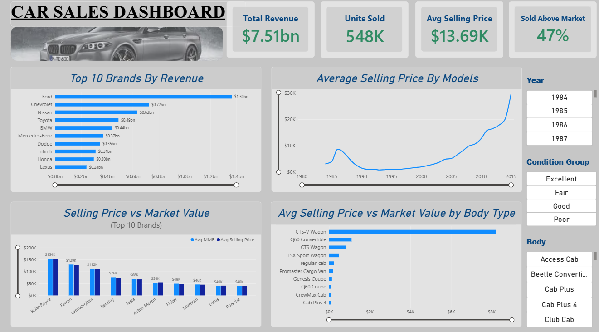

# Car-Sales-Powerbi-Dashboard

Power BI used car sales dashboard | Power Query, DAX, data modeling

By Mohamed Riduvan Azber

## Problem
Understand what drives revenue in used car sales and how selling prices compare to market value.

## Data
548K sales from Kaggle (car_prices): make, body, condition, odometer, MMR, selling price, sale date.

## What I did
- Cleaned data in Power Query (blanks, text, dates, body groups)
- Standardized the mixed condition scale
- Wrote DAX measures for revenue, units, average price and % sold above market
- Designed an interactive dashboard with KPIs, rankings, price analysis and slicers

## Key insights
- Revenue: $7.51bn across 548K units
- 47% of cars sold above market value
- Ford led revenue, followed by Chevrolet and Nissan
- Newer model years sell for far more, rising sharply after 2005
- Luxury brands like Rolls-Royce and Ferrari have the highest average prices

## Tools
Power BI, Power Query, DAX

## Files
- [Presentation](Car_Sales_Presentation.pdf)
- Car_Sales_Dashboard.pbix
